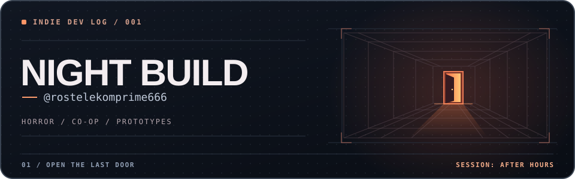

  

Делаю инди-игры: психологический хоррор, кооператив и прототипы странных механик. Люблю, когда обычное место становится жутким без единого скримера, а в коопе друзья сами создают половину хаоса.

| Направление | Что пробую |
| :--- | :--- |
| **01 / Horror** | Ветвящиеся истории, таймеры и выборы с последствиями. |
| **02 / Co-op** | Игры, где друзья могут и выручить, и устроить катастрофу. |

`Unity` · `C#` · `Ren’Py` · `Blender`

## Змейка коммитов

<picture>
  <source media="(prefers-color-scheme: dark)" srcset="./assets/snake-dark.svg">
  <source media="(prefers-color-scheme: light)" srcset="./assets/snake-light.svg">
  
</picture>
